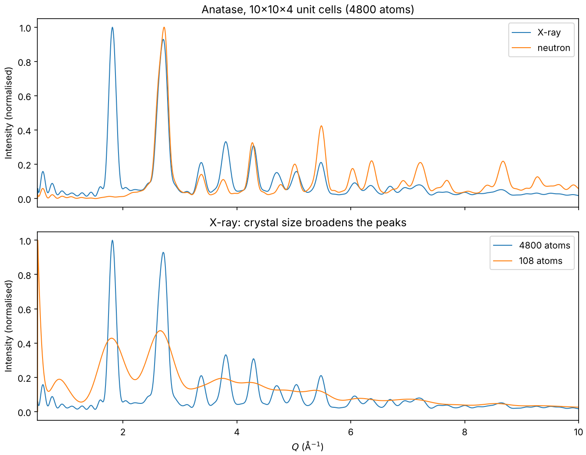

# DiffuseCode from Python

`python/diffuse/` is an early Python API for DISCUS. It currently covers a
small set of commands: reading a structure and calculating a powder pattern.
The results are NumPy arrays, so they can be plotted with matplotlib or any
other library.

```python
import diffuse as dc

cr = dc.read_structure("examples/anatase.cif", supercell=(10, 10, 4))
print(cr)            # Crystal('anatase.cif', supercell=(10, 10, 4), natoms=4800, ...)

p = dc.powder(cr, qmin=0.5, qmax=10, dq=0.005, radiation="xray")
p.q, p.intensity     # NumPy arrays
p.plot()             # matplotlib; p.plot(x="tth") for 2-theta
```



## Running the demo

Build DiffuseCode with the Python module (from the repository root):

```bash
FC=gfortran CC=gcc CXX=g++ cmake -S . -B build -DCMAKE_BUILD_TYPE=Release \
    -DDIFFUSE_PYTHON=ON -DPGPLOT_DIR=/usr/lib/pgplot5
```

```bash
cmake --build build -j
```

Then run the demo (needs NumPy and matplotlib):

```bash
DIFFUSE_PYTHON_PATH=build/python PYTHONPATH=python python3 python/examples/powder_demo.py --show
```

It reads `examples/anatase.cif`, calculates X-ray and neutron patterns for a
10×10×4 supercell and an X-ray pattern for a 3×3×1 crystal, and writes
`powder_demo.png`.

For Jupyter, set the two variables before starting it, or at the top of the
notebook before `import diffuse`:

```python
import os, sys
os.environ["DIFFUSE_PYTHON_PATH"] = "/path/to/build/python"
sys.path.insert(0, "/path/to/DiffuseCode/python")
import diffuse as dc
```

## What is in the API

| Call | What it does |
|---|---|
| `read_structure(path, supercell=None)` | Reads `.cif` or `.cell` (asymmetric unit; space group applied, `supercell` cells built) or `.stru` (whole crystal, read as is). Returns a `Crystal`. |
| `Crystal.natoms`, `.lattice`, `.volume` | Atom count, `(a, b, c, alpha, beta, gamma)`, cell volume |
| `Crystal.atoms()`, `.positions()` | Atom names and fractional coordinates as arrays |
| `powder(crystal, qmin, qmax, dq, radiation, wavelength, method, temperature, lp_correction)` | Powder pattern on a Q grid. `radiation`: `"xray"`, `"neutron"`, `"electron"`; `method`: `"debye"` or `"complete"`. Returns a `PowderPattern`. |
| `PowderPattern.q`, `.intensity`, `.two_theta()`, `.plot()` | Results and a quick matplotlib plot |
| `run_macro(text)` | Runs any DISCUS macro text, for commands that are not wrapped yet |
| `MacroError` | Raised when a DISCUS command fails; the message holds the `***` error lines |

## How it works, and its limits

This version drives the existing f2py module `suite_python`
(`python/suite_python.f90`). Python writes the commands to a small macro,
DISCUS runs it in the same process, and the results come back through
files or KUPLOT data sets. See `diffuse/_session.py`.

* DISCUS holds **one structure at a time** per process. A `Crystal` remembers
  how it was made, and `powder()` reads it in again if another structure was
  loaded since.
* DISCUS output is captured, not printed. Set `DIFFUSE_ECHO=1`, or call
  `dc.session(echo=True)`, to see it. The last output is in
  `dc.session().last_output`.
* Input files are copied to a scratch folder first, because DISCUS writes
  converted files (for example `.stru` from `.cif`) next to its input.

The migration plan (`migration/DiffuseCode_Python_Migration_Plan.md`,
WP1–WP5) replaces `suite_python` underneath with a `bind(C)` core and a
proper `pip install`. The aim is to keep this API while doing so.

## Tests

`tests/python/test_diffuse_api.py` covers this API, and CI runs it together
with the demo script. See `tests/README.md`.
